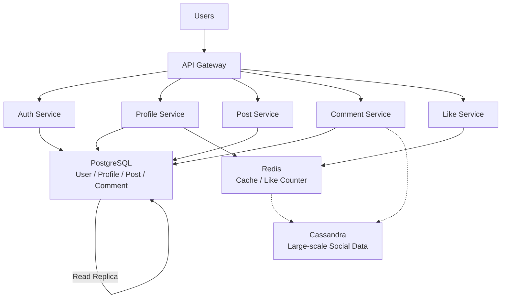

# Consistency Models - Social Network

## 1. Consistency Strategy

Hệ thống Social Network gồm 5 tính năng chính:

- **Register / Login**
- **Update Profile**
- **Create Post**
- **Comment**
- **Like Count**

Không nên áp dụng một `Consistency Model` cho toàn bộ hệ thống. Mỗi tính năng có yêu cầu khác nhau về tính chính xác của dữ liệu, latency và availability.

### Consistency Strategy

| Feature          | Consistency Model        | Storage            | Priority                      |
| ---------------- | ------------------------ | ------------------ | ----------------------------- |
| Register / Login | **Strong Consistency**   | PostgreSQL         | Data correctness              |
| Update Profile   | **Read-Your-Writes**     | PostgreSQL + Redis | User experience               |
| Create Post      | **Read-Your-Writes**     | PostgreSQL         | Immediate visibility          |
| Comment          | **Causal Consistency**   | PostgreSQL         | Correct ordering              |
| Like Count       | **Eventual Consistency** | Redis + Cassandra  | Low latency & high throughput |

---

## 1.1 Register / Login → Strong Consistency

### Consistency Model

**Strong Consistency**

Sau khi một tài khoản được tạo hoặc cập nhật thành công, các lần đọc tiếp theo phải nhìn thấy dữ liệu mới nhất.

### Vì sao chọn?

Đăng ký và đăng nhập liên quan trực tiếp đến `Identity` của người dùng.

Ví dụ:

```text
User Register
     ↓
Create Account
     ↓
Register Success
     ↓
Login
     ↓
Account must exist immediately
```

Không thể chấp nhận trường hợp:

```text
Register Success
      ↓
Login immediately
      ↓
Account not found
```

Hoặc:

```text
Two requests register the same email
      ↓
Duplicate Account ❌
```

Vì vậy cần đảm bảo dữ liệu account được ghi và đọc với consistency cao.

### Technology

**PostgreSQL**

Có thể sử dụng:

- `UNIQUE constraint` cho email/username.
- `ACID Transaction`.
- Primary database cho các thao tác ghi quan trọng.
- Replica chỉ sử dụng cho các trường hợp read phù hợp.

Ví dụ:

```sql
CREATE UNIQUE INDEX idx_users_email
ON users(email);
```

### Trade-off

**Ưu điểm:**

- Dữ liệu account chính xác.
- Tránh duplicate account.
- Login không bị đọc dữ liệu stale.

**Nhược điểm:**

- Latency có thể cao hơn.
- Khả năng chịu partition thấp hơn nếu phải đảm bảo consistency tuyệt đối.

---

## 1.2 Update Profile → Read-Your-Writes

### Consistency Model

**Read-Your-Writes Consistency**

Sau khi user cập nhật profile thành công, chính user đó phải nhìn thấy dữ liệu vừa cập nhật.

Ví dụ:

```text
User changes avatar
        ↓
Update Profile Success
        ↓
User reloads page
        ↓
New avatar must be visible
```

Không nên xảy ra:

```text
Update avatar → Success
        ↓
Reload
        ↓
Old avatar ❌
```

### Vì sao chọn?

Profile không nhất thiết yêu cầu toàn hệ thống phải nhìn thấy dữ liệu mới ngay lập tức.

Ví dụ:

```text
User A updates avatar
```

User A cần thấy avatar mới ngay.

Nhưng một user khác có thể tạm thời nhìn thấy avatar cũ trong vài giây mà không gây ảnh hưởng nghiêm trọng.

Do đó `Read-Your-Writes` phù hợp hơn `Strong Consistency` cho trải nghiệm người dùng.

### Technology

**PostgreSQL + Redis**

PostgreSQL lưu dữ liệu chính.

Redis có thể sử dụng làm cache:

```text
Client
   ↓
Profile Service
   ↓
PostgreSQL
   ↓
Update Redis Cache
```

Hoặc sau khi update thành công có thể:

```text
Write DB
   ↓
Invalidate / Update Cache
   ↓
Next Read
   ↓
Return latest value
```

### Trade-off

**Ưu điểm:**

- User luôn thấy thay đổi của chính mình.
- Giảm dependency vào Strong Consistency cho toàn hệ thống.
- Có thể sử dụng cache để giảm latency.

**Nhược điểm:**

- Phải quản lý cache invalidation.
- Có thể xảy ra stale data đối với user khác.

---

## 1.3 Create Post → Read-Your-Writes

### Consistency Model

**Read-Your-Writes Consistency**

Sau khi bài viết được tạo thành công, người tạo bài phải nhìn thấy bài viết ngay.

### Vì sao chọn?

Ví dụ:

```text
User creates Post
       ↓
Post created successfully
       ↓
User opens Profile / News Feed
       ↓
New Post must be visible
```

Nếu hệ thống trả về:

```text
"Post created successfully"
```

nhưng user reload trang lại không thấy bài viết của mình thì trải nghiệm rất tệ.

Tuy nhiên, không nhất thiết tất cả users trong hệ thống phải nhìn thấy bài viết mới ngay lập tức.

### Technology

**PostgreSQL**

Post được lưu vào PostgreSQL.

Có thể sử dụng:

- PostgreSQL Primary cho write.
- Read Replica cho các read không yêu cầu immediate consistency.
- Cache để giảm latency.

Đối với chính user vừa tạo bài, có thể đảm bảo request đọc tiếp theo đi qua `Primary` hoặc cơ chế session-aware routing để đạt `Read-Your-Writes`.

### Trade-off

**Ưu điểm:**

- User thấy bài viết ngay.
- Không cần Strong Consistency cho toàn bộ Social Network.
- Có thể scale read bằng Replica.

**Nhược điểm:**

- Cần quản lý routing giữa Primary và Replica.
- Replica có thể bị `Replication Lag`.

---

## 1.4 Comment → Causal Consistency

### Consistency Model

**Causal Consistency**

Các thao tác có quan hệ nguyên nhân - kết quả phải được nhìn thấy theo đúng thứ tự.

Ví dụ:

```text
Post created
     ↓
Comment created
     ↓
Reply created
```

Không nên xảy ra:

```text
Reply appears
     ↓
Original Comment appears later
```

### Vì sao chọn?

Comment thường có quan hệ nhân quả.

Ví dụ:

```text
Post A
   ↓
Comment B
   ↓
Reply C
```

User phải nhìn thấy:

```text
Post A → Comment B → Reply C
```

thay vì:

```text
Reply C
   ↓
Comment B
   ↓
Post A
```

`Causal Consistency` phù hợp vì hệ thống không nhất thiết phải đảm bảo mọi node đồng bộ tuyệt đối ngay lập tức, nhưng các thao tác có quan hệ với nhau phải giữ đúng thứ tự.

### Technology

Có thể sử dụng:

**PostgreSQL** cho hệ thống có quy mô vừa hoặc yêu cầu quan hệ dữ liệu rõ ràng.

Hoặc:

**Cassandra** khi hệ thống cần scale rất lớn với lượng comment/read/write cao.

Một thiết kế đơn giản:

```text
Comment Service
       ↓
PostgreSQL
       ↓
Comment Data
```

Khi scale lớn:

```text
Comment Service
       ↓
Cassandra
       ↓
Comment Nodes
```

### Trade-off

**Ưu điểm:**

- Giữ được thứ tự nhân quả.
- Có thể scale tốt hơn Strong Consistency toàn hệ thống.
- Phù hợp với quan hệ Post → Comment → Reply.

**Nhược điểm:**

- Logic application phức tạp hơn.
- Cần theo dõi quan hệ giữa các thao tác.
- Có thể phải xử lý delayed/stale data.

---

## 1.5 Like Count → Eventual Consistency

### Consistency Model

**Eventual Consistency**

Like count không cần chính xác tuyệt đối tại từng millisecond.

Nếu không có update mới, cuối cùng các node sẽ hội tụ về cùng một giá trị.

### Vì sao chọn?

Like là thao tác có tần suất rất cao.

Ví dụ:

```text
Post Viral
   ↓
100,000 users
   ↓
Like requests
```

Nếu mỗi Like đều phải ghi trực tiếp vào một database với Strong Consistency, database có thể trở thành bottleneck.

Có thể sử dụng:

```text
User
 ↓
Like Service
 ↓
Redis Counter
 ↓
Async Processing
 ↓
Persistent Database
```

Trong một khoảng thời gian ngắn:

```text
UI:        10,001 likes
Actual:    10,005 likes
```

Trường hợp này có thể chấp nhận được.

Điều quan trọng là sau khi không còn update mới:

```text
10,005
   ↓
All replicas eventually converge
   ↓
10,005
```

### Technology

**Redis**

Sử dụng Redis Counter để xử lý lượng Like lớn với latency thấp.

Ví dụ:

```text
INCR post:123:likes
```

Sau đó có thể đồng bộ dữ liệu xuống persistent storage thông qua asynchronous processing.

**Cassandra** có thể được sử dụng để lưu trữ dữ liệu Like ở quy mô lớn.

### Trade-off

**Ưu điểm:**

- Low Latency.
- High Throughput.
- Dễ scale horizontally.
- Giảm tải cho relational database.

**Nhược điểm:**

- Like count có thể stale trong thời gian ngắn.
- Cần xử lý duplicate Like.
- Cần xử lý retry và idempotency.
- Cần cơ chế đồng bộ dữ liệu xuống persistent storage.

---

# 2. Consistency Model Comparison

| Model                    | Data Freshness            | Latency    | Availability | Complexity | Use Case         |
| ------------------------ | ------------------------- | ---------- | ------------ | ---------- | ---------------- |
| **Strong Consistency**   | Ngay lập tức              | Cao hơn    | Thấp hơn     | Thấp       | Register / Login |
| **Read-Your-Writes**     | User thấy write của mình  | Trung bình | Cao          | Trung bình | Profile / Post   |
| **Causal Consistency**   | Giữ đúng quan hệ nhân quả | Trung bình | Cao          | Cao        | Comment / Reply  |
| **Eventual Consistency** | Có thể stale              | Thấp       | Cao          | Cao        | Like Count       |

### Lựa chọn tổng thể

Không sử dụng `Strong Consistency` cho toàn bộ Social Network.

Thay vào đó:

```text
Critical Identity Data
        ↓
Strong Consistency

User-generated Data
        ↓
Read-Your-Writes

Related Operations
        ↓
Causal Consistency

High-volume Counter
        ↓
Eventual Consistency
```

---

# 3. Database & Storage

## 3.1 PostgreSQL

Sử dụng PostgreSQL cho dữ liệu yêu cầu consistency và transaction cao:

- User Account
- Authentication
- Profile
- Post
- Comment

Lý do:

- ACID Transaction.
- Relational model phù hợp với User/Post/Comment.
- `UNIQUE constraint` giúp bảo vệ dữ liệu.
- Hỗ trợ transaction và locking.

---

## 3.2 Redis

Sử dụng Redis cho các dữ liệu cần latency thấp:

- Like Counter.
- Profile Cache.
- Session / temporary data.

Ưu điểm:

- In-memory.
- Low Latency.
- High Throughput.
- Hỗ trợ Counter.
- Có thể scale bằng Redis Cluster.

---

## 3.3 Cassandra

Có thể sử dụng Cassandra khi hệ thống có lượng dữ liệu Social Network rất lớn.

Phù hợp với:

- Like events.
- Comment data ở quy mô lớn.
- Activity / Timeline data.

Ưu điểm:

- High Availability.
- Horizontal Scaling.
- High Write Throughput.
- Eventual Consistency.

---

# 4. System Architecture



### Data Flow

#### Register / Login

```text
Client
  ↓
API Gateway
  ↓
Auth Service
  ↓
PostgreSQL
```

Ưu tiên **Strong Consistency**.

---

#### Update Profile

```text
Client
  ↓
Profile Service
  ↓
PostgreSQL
  ↓
Redis Cache
```

Ưu tiên **Read-Your-Writes**.

---

#### Create Post

```text
Client
  ↓
Post Service
  ↓
PostgreSQL
```

Ưu tiên **Read-Your-Writes** cho người tạo bài.

---

#### Comment

```text
Client
  ↓
Comment Service
  ↓
PostgreSQL / Cassandra
```

Ưu tiên **Causal Consistency** để đảm bảo quan hệ:

```text
Post → Comment → Reply
```

---

#### Like Count

```text
Client
  ↓
Like Service
  ↓
Redis Counter
  ↓
Async Processing
  ↓
Persistent Storage
```

Ưu tiên **Eventual Consistency**.

---

# 5. Trade-offs

| Feature          | Chọn                     | Đánh đổi                                    |
| ---------------- | ------------------------ | ------------------------------------------- |
| Register / Login | **Strong Consistency**   | Đổi latency/availability để lấy correctness |
| Update Profile   | **Read-Your-Writes**     | Cần xử lý Cache/Replica routing             |
| Create Post      | **Read-Your-Writes**     | Cần đảm bảo user thấy write của mình        |
| Comment          | **Causal Consistency**   | Tăng complexity để giữ causal order         |
| Like Count       | **Eventual Consistency** | Chấp nhận stale count để lấy throughput     |

### Nguyên tắc thiết kế

Không phải dữ liệu nào cũng cần `Strong Consistency`.

Chỉ nên sử dụng consistency mạnh cho những dữ liệu mà việc đọc dữ liệu cũ có thể gây ra lỗi nghiệp vụ nghiêm trọng.

Đối với các dữ liệu như `Like Count`, có thể chấp nhận stale data trong thời gian ngắn để đổi lấy:

- Low Latency
- High Availability
- High Throughput
- Horizontal Scalability

---

# 6. Final Summary

| Feature              | Consistency Model    | Technology             |
| -------------------- | -------------------- | ---------------------- |
| **Register / Login** | Strong Consistency   | PostgreSQL             |
| **Update Profile**   | Read-Your-Writes     | PostgreSQL + Redis     |
| **Create Post**      | Read-Your-Writes     | PostgreSQL             |
| **Comment**          | Causal Consistency   | PostgreSQL / Cassandra |
| **Like Count**       | Eventual Consistency | Redis + Cassandra      |

### Final Design

```text
                    Social Network
                          │
                    ┌─────▼─────┐
                    │ API Gateway│
                    └─────┬─────┘
                          │
        ┌─────────────────┼─────────────────┐
        │                 │                 │
       Auth            Profile             Post
        │                 │                 │
        ▼                 ▼                 ▼
   PostgreSQL       PostgreSQL          PostgreSQL
                         │
                         ▼
                       Redis

        ┌─────────────────┐      ┌─────────────────┐
        │    Comment      │      │      Like       │
        └────────┬────────┘      └────────┬────────┘
                 │                        │
                 ▼                        ▼
          PostgreSQL /              Redis Counter
           Cassandra                     │
                                         ▼
                                     Cassandra
```

Thiết kế sử dụng **nhiều Consistency Model** thay vì áp dụng một model duy nhất cho toàn bộ hệ thống.

Mục tiêu là cân bằng giữa:

```text
Correctness
     +
User Experience
     +
Low Latency
     +
High Availability
     +
Scalability
```

Đây là cách tiếp cận phù hợp với một Social Network vì mỗi loại dữ liệu có mức độ quan trọng và yêu cầu consistency khác nhau.
